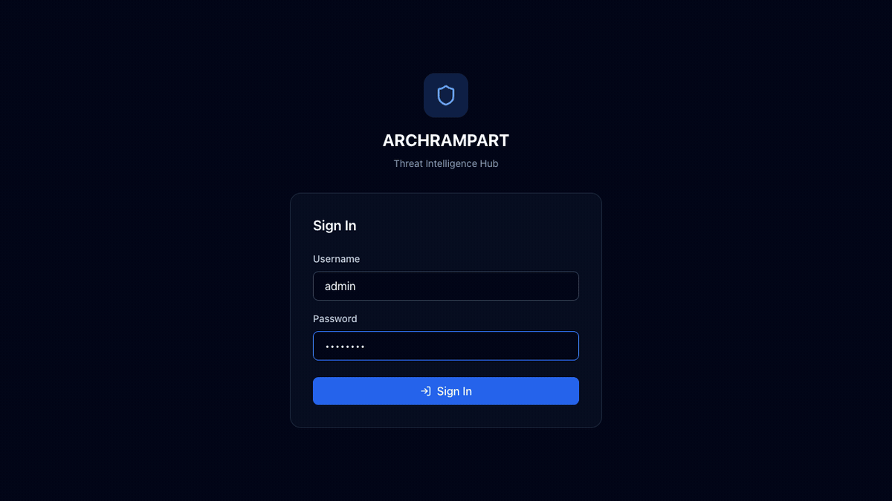

# Threat Intelligence Platform

A web application for querying, analyzing, and reporting on IOC (Indicators of Compromise) using open-source threat intelligence APIs.

## 🎬 Demo



*Dashboard · bulk IOC search with defanged input · CVE exploit intelligence (EPSS, CISA KEV, public exploits) ·
dark web monitoring (leak sites, infostealers, forums, Telegram, source health) · reports · personal API key catalog*

## 🚀 Quick Start

### Requirements

- **Python 3.12+** (for Backend)
- **Node.js 20.19+ (24 LTS recommended) and npm 10+** (for Frontend - optional)
- **Docker & Docker Compose** (for containerized deployment - optional)

### Option 1: Docker Deployment (Recommended)

```bash
# Start all services with one command
./docker-start.sh

# Or directly
docker-compose up -d
```

This will start:
- Redis (for caching)
- Backend API (FastAPI)
- Frontend (React + Nginx)

`docker-start.sh` generates strong `SECRET_KEY`, `ENCRYPTION_KEY` and `REDIS_PASSWORD`
values in `.env` on first run. The containers refuse to start in production mode with
default or weak secrets.

**Access URLs:**
- Frontend: http://localhost:4765 (the API is proxied under `/api`)
- API Documentation: http://127.0.0.1:8777/docs (bound to localhost only)
- First login: see [Default Credentials](#default-credentials)

### Option 2: Local Development

#### Start with Script

```bash
./start.sh
```

This script:
- ✅ Automatically sets up and starts the backend
- ✅ Sets up and starts the frontend (if Node.js is installed)
- ✅ Creates necessary `.env` files
- ✅ Runs both services in parallel

#### Manual Setup

##### Backend Only

```bash
cd backend
python3 -m venv .venv
source .venv/bin/activate  # Linux/Mac
pip install -r requirements.txt
uvicorn app.main:app --reload --host 127.0.0.1 --port 8000
```

##### Frontend (Node.js required)

```bash
# Install Node.js (Mac - with Homebrew)
brew install node

# Install Node.js (Linux)
curl -fsSL https://deb.nodesource.com/setup_20.x | sudo -E bash -
sudo apt-get install -y nodejs

# Install and start frontend
cd frontend
npm install
npm run dev
```

### Default Credentials

| Mode | Username | Password | Role |
|------|----------|----------|------|
| Docker / production | `admin` | `DEFAULT_ADMIN_PASSWORD` from `.env`, or a random one printed once in the backend log | Admin |
| Local development (`ENVIRONMENT=development`) | `admin` | `admin123` | Admin |
| | `analyst` | `analyst123` | Analyst |
| | `viewer` | `viewer123` | Viewer (read-only) |

Read the generated admin password with:

```bash
docker compose logs backend | grep "Initial admin"
```

The demo accounts are only created in development or when `SEED_DEFAULT_USERS=true`.
Never enable them on an exposed instance, and change the admin password after the first login.

## 📁 Project Structure

```
threat_intelligence/
├── backend/          # FastAPI backend
│   ├── app/
│   │   ├── api/      # API endpoints
│   │   ├── core/     # Config, security, SSRF guard (url_guard.py)
│   │   ├── db/       # Seeding, source catalog (source_catalog.py)
│   │   ├── models/   # SQLAlchemy models
│   │   ├── schemas/  # Pydantic schemas
│   │   └── services/ # Business logic (darkweb/, report_builder.py, exploit_intel.py, ...)
│   ├── scripts/      # Maintenance (recompute_risk_scores.py, backup_database.py)
│   ├── tests/
│   ├── requirements.txt      # runtime
│   └── requirements-dev.txt  # tests, linters, pip-audit
├── frontend/         # React + Vite frontend
│   ├── src/
│   │   ├── features/ # Feature modules
│   │   ├── components/ # UI components
│   │   └── lib/      # API client
│   └── package.json
├── docker/           # Docker configuration files
│   ├── Dockerfile.backend
│   ├── Dockerfile.frontend
│   └── nginx.conf
├── docker-compose.yml  # Docker Compose configuration
├── docker-start.sh     # Docker startup script
└── start.sh            # Local development startup script
```

## 🌐 Access URLs

### Local Development

After backend starts:
- **Backend API**: http://127.0.0.1:8000
- **API Documentation**: http://127.0.0.1:8000/docs
- **Health Check**: http://127.0.0.1:8000/api/v1/health

After frontend starts:
- **Frontend**: http://localhost:5173

### Docker Deployment

- **Frontend**: http://localhost:4765
- **API (via frontend proxy)**: http://localhost:4765/api/v1
- **API Documentation**: http://127.0.0.1:8777/docs

## 🔧 Configuration

### Backend (`backend/.env`, see `backend/.env.example`)

| Variable | Default | Purpose |
|---|---|---|
| `ENVIRONMENT` | `development` | `production` enforces strong secrets, Secure cookies, HSTS, no demo users |
| `SECRET_KEY`, `ENCRYPTION_KEY` | dev values | JWT signing / API key encryption. **Required (>= 32 chars) in production.** Changing `ENCRYPTION_KEY` makes stored API keys unreadable |
| `DATABASE_URL` | `sqlite:///./threat_intel.db` | SQLAlchemy URL |
| `CORS_ORIGINS` | - | Extra browser origins (comma separated); dev servers on localhost are allowed automatically |
| `SEED_DEFAULT_USERS` | on in dev | Demo users `admin/admin123`, `analyst/analyst123`, `viewer/viewer123` |
| `DEFAULT_ADMIN_PASSWORD` | random | First admin password in production (otherwise printed once in the log) |
| `COOKIE_SECURE` | production only | Secure flag on session cookies |
| `TRUST_PROXY_HEADERS` | `false` | Use `X-Real-IP` / `X-Forwarded-For` for rate limiting (only behind your own proxy) |
| `REDIS_ENABLED`, `REDIS_URL` | `false` | Shared cache |
| `IOC_QUERY_CONCURRENCY` | `8` | Sources queried in parallel per IOC |
| `ALLOW_PRIVATE_API_TARGETS` | `false` | Allow API sources / feeds on internal addresses (SSRF risk, lab only) |
| `EXPLOIT_INTEL_PREFETCH` | `true` | Download Exploit-DB / Nuclei / Metasploit catalogs at startup |
| `DARKWEB_MONITOR_ENABLED` | `true` | Scheduled dark web scans |
| `DARKWEB_SCAN_INTERVAL_MINUTES` | `60` | Scan interval (minimum 15) |
| `WATCHLIST_SCHEDULER_ENABLED` | `false` | Automatic watchlist checks (uses API quota) |
| `METRICS_PUBLIC` | `false` | `/api/v1/metrics` without admin login |

### Frontend (`frontend/.env`)

```bash
VITE_API_BASE_URL=http://127.0.0.1:8000
```

In development the browser always calls `/api/v1` on the Vite dev server, which forwards to this
address (same origin, so session cookies work). Production builds use `/api/v1` behind nginx.

### Docker (`.env`)

`./docker-start.sh` creates `.env` and generates `SECRET_KEY`, `ENCRYPTION_KEY` and `REDIS_PASSWORD`.
See `.env.example` for the other options (`DEFAULT_ADMIN_PASSWORD`, `CORS_ORIGINS`, `COOKIE_SECURE`,
`DARKWEB_*`, ...).

### Upgrading from 2.0

1. Install the new dependencies (`pip install -r backend/requirements.txt`, `npm ci` in `frontend/`)
2. Start the app once: new tables are created and the source catalogs are seeded automatically
3. Recompute stored risk scores (old versions counted "unknown" results as high risk):
   ```bash
   cd backend && python -m scripts.recompute_risk_scores          # dry run: before/after per bucket
   cd backend && python -m scripts.recompute_risk_scores --apply  # writes, keeps a timestamped .bak
   ```
4. Everyone signs in again (sessions moved to cookies); add your own API keys (keys are personal) and
   your abuse.ch Auth-Key
5. Reports created with 2.0 cannot be converted to other formats; create them again

## 📚 Features

### ✅ Completed Modules

- **Authentication**: JWT-based user login and registration
- **IOC Query**: IP, Domain, URL, Hash, Email, and CVE querying across ~45 maintained sources
  (API lookups plus blocklist feeds checked by exact / CIDR membership)
- **Dashboard**: Statistics and metrics with interactive charts
- **CVE Database**: NIST NVD search enriched with **FIRST EPSS**, **CISA KEV** (known exploited /
  ransomware use) and **public exploit availability** (Metasploit, Exploit-DB, Nuclei, GitHub PoCs) -
  filter by KEV or **PoC gap**, sort by EPSS / CVSS / newest
- **Bulk IOC input**: paste reports or logs (defanged values supported), query with progress, export CSV
- **Exports**: IOC history as JSON, **STIX 2.1** bundle or **MISP** event
- **Notifications**: per-user Slack / Teams / generic webhooks for watchlist and dark web alerts
- **Dark web monitoring**: your domains, e-mail domains and brand names checked against ransomware leak
  sites (ransomware.live, RansomLook), infostealer logs (Hudson Rock), breaches (HIBP) and Telegram channels
  (public preview or your own Telegram account)
- **Watchlist**: Asset monitoring and alert system
- **Reports**: IOC reports (executive summary, findings with evidence) and dark web exposure reports, as
  PDF, HTML, JSON or CSV; IOC reports can include a dark web summary
- **API Key Management**: API keys encrypted at rest (Fernet)
- **API Source Management**: curated pre-configured sources + custom API sources (admin only,
  outbound URLs validated against SSRF)
- **Alert System**: Real-time alert notifications for watchlist items
- **Redis Caching**: High-performance caching for IOC and CVE queries
- **Background Jobs**: Automated watchlist monitoring
- **User Roles**: Admin, Analyst, and Viewer role-based access control

### 🔄 Development Status

- Most core features are complete
- Frontend UI fully implemented
- Protected routes implemented
- PDF export available
- Background task system implemented

## 🛠️ Development

### Backend Testing

```bash
cd backend
source .venv/bin/activate
pip install -r requirements-dev.txt
pytest -p no:asyncio
pip-audit -r requirements.txt
```

### Frontend Checks

```bash
cd frontend
npm run lint
npm run build
npm audit --omit=dev
```

### Stack

FastAPI 0.162 / Starlette 1.x, SQLAlchemy 2.1, Pydantic 2.14, Python 3.12+ (Docker: 3.13);
React 19, React Router 7, Vite 8, TypeScript 6, Tailwind CSS 4, TanStack Query 5.

## 📝 Notes

- SQLite is used in development environment
- PostgreSQL is recommended for production
- API keys are encrypted at rest (Fernet / AES-128-CBC + HMAC-SHA256, PBKDF2-derived key)
- Browser sessions use httpOnly SameSite=Strict cookies with refresh-token rotation; API clients can
  use `Authorization: Bearer` (15 min access tokens, HS256, issuer and expiry enforced)
- API keys and webhook URLs are personal: queries only use the caller's own keys
- Redis cache is enabled by default in Docker (password protected, internal network only)
- See [USAGE.md](USAGE.md) for the user guide and [CHANGELOG.md](CHANGELOG.md) for all 2.1.0 changes

## 🤝 Contributing

1. Fork the repository
2. Create a feature branch (`git checkout -b feature/amazing-feature`)
3. Commit your changes (`git commit -m 'Add amazing feature'`)
4. Push to the branch (`git push origin feature/amazing-feature`)
5. Open a Pull Request

## 📄 License

This project is open source.
